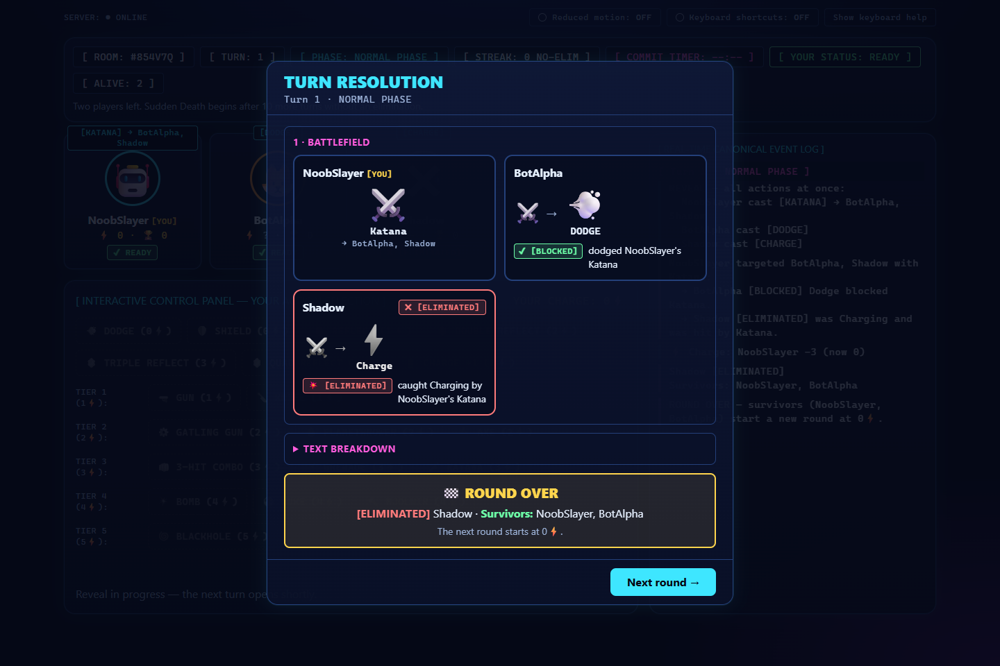
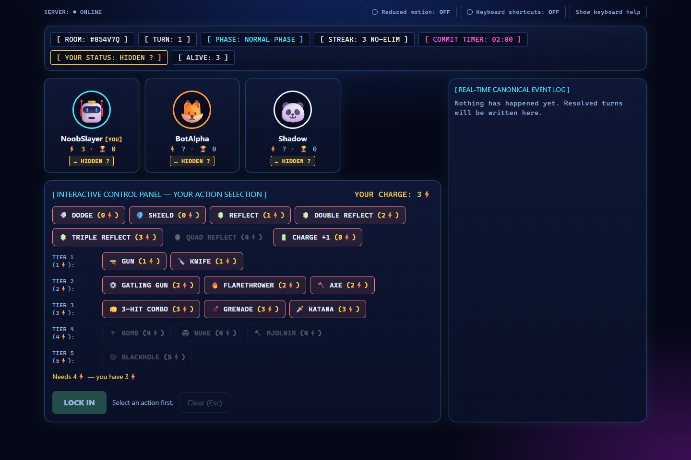
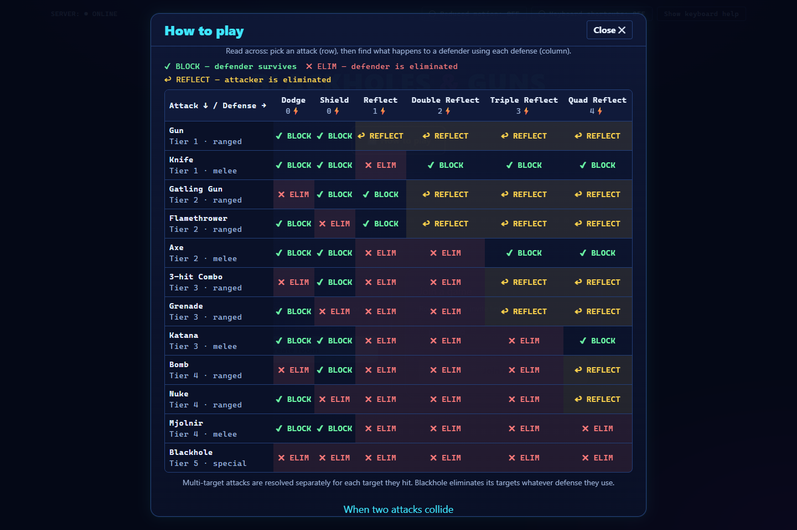

# Blackholes & Guns

A real-time, 2-8 player elimination game: everyone **secretly picks an action, all actions are revealed at once, and the server resolves them together**. Last player standing wins the match; first to 10 match wins takes the series.

It is also a deliberately **test-first, spec-driven build**: a pure deterministic rules engine, an authoritative Socket.IO server, and a React client, developed in five gated phases with Claude Code and verified by 708 automated tests.



---

## Contents
- [The game](#the-game)
- [What's in the box](#whats-in-the-box)
- [Tech stack](#tech-stack)
- [Architecture](#architecture)
- [AI agent methodology](#ai-agent-methodology)
- [Testing & failsafes](#testing--failsafes)
- [How to run](#how-to-run)
- [Playtesting remotely with ngrok](#playtesting-remotely-with-ngrok)
- [Project structure](#project-structure)
- [Known limitations](#known-limitations)

---

## The game

Every turn is a **simultaneous, hidden-information** decision:

1. **OPEN**: the server opens a commit window with a countdown.
2. **COMMIT**: each living player secretly picks one action and locks it in. Rivals see *that* you locked in (`READY`), never *what* (`HIDDEN ?`).
3. **LOCK / REVEAL**: when everyone has locked in (or time runs out) all actions are revealed at the same instant.
4. **RESOLVE / APPLY**: the engine resolves every interaction against a fixed rules matrix and eliminates players.

| Piece | Rules |
|---|---|
| **Charge** | The economy. Charging gives +1 (cap 5). Attacks and Reflects cost Charge. You only ever see **your own** balance. |
| **12 attacks, 5 tiers** | Tier 1 Gun, Knife - Tier 2 Gatling Gun, Flamethrower, Axe - Tier 3 3-hit Combo, Grenade, Katana - Tier 4 Bomb, Nuke, Mjolnir - Tier 5 Blackhole. Cost equals tier. Each is ranged, melee or special, and hits 1, up to 3, or all opponents. |
| **6 defenses** | Dodge and Shield (free); Reflect, Double, Triple and Quad Reflect (1-4 Charge). |
| **12x6 interaction matrix** | Every attack/defense pair resolves to *block*, *eliminate* or *reflect* (the attacker is eliminated). |
| **Attack vs. attack** | Only between two players attacking *each other* (rules v1.1): higher tier wins; at equal tier, ranged beats melee; equal tier and class cancel out; Blackhole beats every attack except another Blackhole. An attacker hit by someone it is *not* attacking has no defense and is eliminated. |
| **Stalemate breakers** | After 10 turns with no elimination (two players left): **Sudden Death**, where defenses are disabled and attacking is mandatory when affordable. After 15: **Overtime**, where normal rules return. There is no draw state. |
| **Structure** | Round, then match (+1 Match Win), then series (first to 10 Match Wins). |

> The rules come from a Game Design Document (GDD v1.0.4) that is **not included** in this repository. Section references like "§9" in code comments and tests point into it.

## What's in the box

- **Lobby**: create a room, share the room code or invite link, watch the 2-8 seat roster fill.
- **Control panel**: the full action bar. Attacks you can't afford are dimmed and `aria-disabled` with the reason on focus ("Needs 4 Charge, you have 3"). Target picker plus an explicit *Lock in* step.
- **Roster and banner**: `READY` / `HIDDEN ?` / `[ELIMINATED]` badges, turn index, phase banner, and the exact no-elimination streak counter.
- **Turn Resolution modal**: an animated "emoji battlefield." Each player is a card; attacks fly into defenders, blocks/reflects/eliminations pop with text tags, and everyone's action plays **in parallel**. Round, match and series results appear in the same modal. A text breakdown is always available.
- **Real-time event log** with multi-line, color-independent outcome tags (`[BLOCKED]`, `[REFLECTED]`, `[ELIMINATED]`, `[CLASH WON]`...).
- **How to play**: an in-app guide whose 12x6 matrix is **generated from the engine's own data**, so the help text can't drift from the rules.
- **Fog of war in the UI**: opponents' Charge is masked everywhere (roster, log, resolution cards).
- **Accessibility**: keyboard-only play, roving-focus action grid, skip links, optional single-key shortcuts (off by default), a reduced-motion switch that also honors the OS setting, focus-trapped dialogs, and no meaning carried by color alone (explicit `[ELIMINATED]` text plus greyscale avatars).

| Charge fog of war, dimmed unaffordable attacks | Generated interaction matrix |
|---|---|
|  |  |

## Tech stack

| Layer | Technology |
|---|---|
| Language | **TypeScript** everywhere (strict, `noUncheckedIndexedAccess`, `exactOptionalPropertyTypes`) |
| Runtime / server | **Node.js** with a plain `http` server and **Socket.IO** 4 |
| Rules engine | Pure, deterministic TypeScript with no I/O and a seeded RNG |
| Frontend | **React 19**, **Vite 8**, **Tailwind CSS 4** |
| State | A pure reducer bound to a Socket.IO store (`useSyncExternalStore`) |
| Unit / integration tests | **Vitest**, Testing Library, jsdom, real `socket.io-client` connections |
| Browser automation | **Playwright** (`playwright-core` driving Microsoft Edge) |
| Remote playtesting | **ngrok** (optional tunnel; see below) |
| AI-assisted development | **Claude Code** |

## Architecture

```
            ┌───────────────────────────── src/engine ─────────────────────────────┐
            │  pure, deterministic rules: catalog, 12x6 matrix, collisions, legality, │
            │  phases (Sudden Death/Overtime), turn resolution, seeded RNG            │
            └───────────────────────────────▲────────────────────────────────────────┘
                                            │ imports (no networking inside)
 ┌───────────────────────── src/server ─────┴───────────────────────────┐
 │  rooms · turn pipeline (OPEN→COMMIT→LOCK→REVEAL→RESOLVE→APPLY→DONE)   │
 │  hidden-information gate · timeout/disconnect policy · reconnect       │
 │  14-event structured telemetry · seeded replay log · /dev test hooks   │
 └───────────────────────────────▲────────────────────────────────────────┘
                                 │ Socket.IO (+ tiny HTTP: /healthz, /api/rooms/:code, static client)
 ┌───────────────────────── web/src ─┴──────────────────────────────────┐
 │  store (socket) → pure reducer → React screens (Home, Lobby, Game)     │
 │  formatters turn canonical resolution events into log text and cards   │
 └────────────────────────────────────────────────────────────────────────┘
```

Design rules that the tests enforce:

- **The server is authoritative.** Clients send intents; they never decide outcomes.
- **The engine is pure.** The same state, actions and seed always produce the same result, which is what makes replays and stall analysis possible.
- **A committed action never leaves the server before REVEAL.** Not in broadcasts, acks, logs or telemetry.
- **Every UI sentence is derived from the canonical resolution events**, never re-implemented, so the text and the picture can't disagree with the engine.

## AI agent methodology

The project was built by directing **Claude Code** through five strategic, gated phases, treating the agent like a fast but unaudited junior engineer: clear scope per phase, hard acceptance gates, and verification of its claims.

| Phase | Scope | Gate before moving on |
|---|---|---|
| **1. Engine** | Pure deterministic engine only: state models, resolver, matrix, collision rules, phase failsafes. **No networking.** | All engine tests green, including the 83 stall scenarios |
| **2. Authoritative server** | Socket.IO rooms, turn pipeline, hidden information, disconnect/timeout policy | Integration tests with multiple real clients: commit, time out, reveal in sync |
| **3. Telemetry, replay, test hooks** | 14 structured lifecycle events, seeded deterministic replay, guarded dev endpoints (seed Charge, force a streak, inject actions) | Replay is byte-identical and detects tampering |
| **4. Web client** | Lobby, control panel, roster/banners, event log, accessibility | Component tests, real-server store tests, real-browser run |
| **5. Polish and acceptance** | FX, end-of-round/match/series presentation, spec sweep | Full suite green, console clean in a real browser |

Then **playtest-driven iterations**, where each bug report came from actually playing: an opponent-Charge information leak, unclear "who eliminated whom" on the round/match screens (leading to the unified Turn Resolution modal), an onboarding guide, and tunnel-friendly networking.

What made this work as a QA exercise rather than "prompt and pray":

- **Spec first, ambiguity resolved by a human.** Where the GDD was silent or contradictory the agent had to ask, and the decision is recorded in the code (for example the four target-count interpretations and keeping Overtime exactly as written).
- **Phase gates.** "Do not move on to networking until all engine tests pass perfectly."
- **The agent's reports were audited, not trusted.** At the start of Phase 4 the Phase 3 report was re-checked and found to overstate the work: the dev endpoints could not actually work, only 7 of 14 telemetry events were logged, `action_submitted` leaked the action type, and several tests were stubs. All were fixed with real tests. Later, while preparing this repository, a Phase 5 "audit" module that returned hard-coded checkmarks (tests that could never fail) was deleted, because `tests/matrix.test.ts` already pins the same facts for real.
- **Mutation-style verification.** After writing tests, the code was deliberately broken (remove an affordability check, ignore reduced motion, make an animation loop, mask the wrong player) to confirm the right test fails. This exposed at least one vacuous test, which was rewritten.
- **Real-environment checks.** Beyond unit tests: real clients against a real server, and a real browser (Edge via Playwright) driving a three-player game, including sampling live CSS animations.

## Testing & failsafes

**708 tests in 22 files, all passing** (`npm test`, about 5 seconds).

| Layer | Files | Tests | What it proves |
|---|---|---|---|
| Engine | 7 | 349 | The full **12x6 matrix (72 cells)**, catalog (costs, tiers, classes, target modes), collision rules, legality, phase transitions, lock rules, round/match/series lifecycle |
| Stall analysis | 1 | 128 | **83 deterministic stall scenarios** (below), reproducibility, and documented known gaps |
| Server | 8 | 87 | Rooms, turn flow, hidden information, timeouts and reconnect, telemetry, replay, dev hooks, network/CORS |
| Web | 6 | 144 | Reducer and formatters, components (a11y, reduced motion, affordability), animations, and an integration test of the real client store against the real server |

### The 83-case stall suite

The GDD cites an 83-case deterministic stall audit but does not publish the cases. I **reconstructed 83 scenarios** from the eight categories it names (defensive mirrors and cross-pairs, reflect loops, charge-greedy, aggressive cash-out, anti-charge, cross-strategy, tier/class collisions, Blackhole mirrors) and ran each through the engine with a seeded RNG:

- **78 of 83 terminate** (longest 15 turns).
- **5 of 83 never end**: Sudden Death lasts only a few turns; if both forced attacks neutralize (Gun/Gun or Knife/Knife), Overtime restores defenses and the rules give it no failsafe. This **contradicts the GDD's "83/83 terminated, 0 stalled"**.
- Those five are recorded as a **golden list**, so any rules or RNG change that moves a scenario in or out must be a conscious decision. Separate characterization tests quantify the gap (a Dodge mirror survives Sudden Death roughly 1 time in 4).

### Hidden information (the highest-risk requirement)

Tests plant a unique sentinel string in a player's committed action and assert that it **appears in nothing any rival client received** before REVEAL: no broadcast, ack, progress event or telemetry. A rejoining player sees *that* rivals locked in, never *what*; their own pending commit is restored privately.

### Determinism and replay

Every series records its initial state, rule/matrix versions, seed and each turn's actions (including server-chosen timeout actions). Replaying produces **byte-identical canonical outcomes**; altering one recorded action **fails verification**; replays under different rule versions are refused.

### Failsafes in the product

- **Timeout policy**: a player who doesn't commit gets a server-chosen action from a seeded RNG, so even timeouts replay deterministically.
- **Idempotent commits** and rejected-action telemetry; illegal actions are refused with a reason.
- **Reconnect**: seats are held with secret resume tokens; the newest socket wins, so a stale disconnect can't drop a player.
- **Input hygiene**: tiny message-size cap, validated room codes, display names trimmed and capped at 24 characters, validated forwarded hosts for invite links.
- **Dev hooks are fenced**: `/dev/*` returns a plain 404 unless `DEV_HOOKS=1`, optionally needs a token, and the server refuses to start with hooks on under `NODE_ENV=production`.
- **Accessibility and UI safety nets**: tests assert reduced motion strips animation classes and that CSS animations are finite.

### Running parts of the suite

```bash
npm test                          # everything
npm test -- tests/stall           # the 83 stall scenarios
npm test -- tests/server          # server + hidden-information + replay + network
npm test -- web/tests             # frontend
npm run typecheck                 # strict TypeScript
npm run visual-check              # real-browser smoke run + screenshots (needs Microsoft Edge)
```

## How to run

**Prerequisites:** Node.js and npm (developed and tested on Node 24). `npm run visual-check` additionally needs Microsoft Edge installed.

```bash
# 1. Clone and install
git clone <your-repo-url>
cd blackholes-and-guns
npm install

# 2. Verify everything
npm test
npm run typecheck

# 3. Build the web client and start the server
npm run build:web
npm start                         # http://localhost:3000
```

Open `http://localhost:3000`, create a room, and join from other browser tabs or windows with the room code. A game needs at least 2 players.

> **Windows tip:** keep the project in a folder path without `&` or other shell-special characters; `cmd.exe` mis-parses them in npm scripts.

### npm scripts

| Script | What it does |
|---|---|
| `npm start` | Server on `:3000`, serving the built client from `web/dist` |
| `npm run build:web` | Production build of the client |
| `npm run dev:server` | Same server entry (use with the Vite dev server) |
| `npm run dev:web` | Vite dev server on `:5173`, proxying `/socket.io` to `:3000` |
| `npm run start:tunnel` | Server in [tunnel mode](#playtesting-remotely-with-ngrok) |
| `npm test` / `npm run test:watch` | Vitest, once / watching |
| `npm run typecheck` | `tsc --noEmit` |
| `npm run visual-check` | Real Edge sessions against a real server; saves screenshots to `.visual/` |

### Configuration (environment variables)

| Variable | Default | Purpose |
|---|---|---|
| `PORT` | `3000` | Listen port |
| `HOST` | all interfaces | Bind address (`127.0.0.1` = local only) |
| `PUBLIC_BASE_URL` | `https://blackholesandguns.io` | Origin used in invite links |
| `CORS_ORIGIN` | server default | `*` or a comma-separated allow-list |
| `COMMIT_WINDOW_MS` | `30000` | Commit window per turn |
| `INTER_TURN_DELAY_MS` | `4000` | Pause after a reveal so clients can animate |
| `RECONNECT_GRACE_MS` | `60000` | How long a disconnected seat is held |
| `SERVER_SEED` | random per room | Fixes the timeout-action RNG |
| `REPLAY_DIR` | off | Write `<seriesId>.replay.json` logs here |
| `DEV_HOOKS` | off | `1` enables `/dev/*` test hooks (refused in production) |
| `DEV_TOKEN` | none | If set, `/dev/*` requests must send it in `x-dev-token` |

Setting a variable: `DEV_HOOKS=1 npm start` (bash/macOS/Linux) or `$env:DEV_HOOKS="1"; npm start` (PowerShell).

### Test hooks (for QA automation)

With `DEV_HOOKS=1` you can drive a live room into hard-to-reach states:

```bash
# give players Charge, fake a 9-turn quiet streak (one more quiet turn = Sudden Death), skip ahead, or inject actions
curl -X POST localhost:3000/dev/charges     -H "content-type: application/json" -d '{"roomCode":"ABC234","charges":{"p1":4}}'
curl -X POST localhost:3000/dev/streak      -H "content-type: application/json" -d '{"roomCode":"ABC234","streak":9}'
# also: POST /dev/fastforward, POST /dev/actions
```

## Playtesting remotely with ngrok

```bash
npm run build:web
npm run start:tunnel      # server in tunnel mode on :3000
ngrok http 3000           # in a second terminal
```

Share the `https://….ngrok-free.app` URL (or the invite link shown in your lobby). Tunnel mode opens CORS and builds invite links from the forwarded host so they point at the tunnel instead of the default domain. The browser client connects to its own origin, so no client config is needed. Tunnel mode refuses to start under `NODE_ENV=production`. Tunnel only the game server (not the Vite dev server). The server has no authentication or rate limiting, so only share the URL with people you trust.

## Project structure

```
src/
  engine/        pure rules engine (catalog, matrix, collisions, legality, phases, resolver, RNG)
  server/        rooms, turn pipeline, Socket.IO gateway, HTTP, telemetry, replay, dev hooks
  env.ts         environment parsing        main.ts / tunnel.ts   entry points
web/
  src/           React client: screens/, components/, format/ (event -> text/emoji), net/, state/
  tests/         client tests (reducer, formatters, components, store <-> real server)
tests/
  *.test.ts      engine tests        stall/   the 83 scenarios      server/   integration tests
scripts/         visual-check.ts (Playwright)
docs/screenshots/
```

## Known limitations

Documented honestly, as a QA project should:

- **Charge fog is UI-level.** Opponents' Charge is masked in every view, but the server still includes all players' state in its payloads. Anyone inspecting socket traffic can read it. A real fix is a per-viewer state projection on the server. Actions, by contrast, are fully protected until REVEAL.
- **No authentication, rate limiting or room-code brute-force protection.** Fine for friends over a tunnel, not for the open internet.
- **Overtime can stall** under the rules as written (see the stall analysis). Kept as specified; tracked by the golden list.
- **The 83 stall scenarios are a reconstruction,** not the original audit suite.
- **Browser coverage:** verified in Microsoft Edge on Windows. Accessibility was checked with automated and keyboard-only testing, not with real screen readers.
- **Avatars and effects are emoji and CSS** placeholders; the GDD is not published here.

## Production Deployment (Railway)

One container serves everything: the Node.js Socket.IO game server and the built web client. The browser connects to its own origin, so there is no client URL to configure. Files involved: [Dockerfile](Dockerfile), [railway.json](railway.json), [.dockerignore](.dockerignore).

**Scripts**

| Command | What it does |
|---|---|
| `npm run build` | Typechecks, then bundles the web client into `web/dist` (Vite). |
| `npm start` | Starts the server (`tsx src/main.ts`; `tsx` is a production dependency because the server runs straight from TypeScript). Serves `web/dist` if it exists. |

**Deploy**

1. Push this repo to GitHub, then in Railway choose **New Project → Deploy from GitHub repo**. Railway reads `railway.json` and builds the Dockerfile.
2. Open the service's **Settings → Networking → Generate Domain**.
3. Add the variables below (service **Variables** tab), then redeploy.
4. Check `https://<your-domain>/healthz` returns `{"ok":true}`, then open the domain and create a room.

**Environment variables**

| Variable | Required | Value / notes |
|---|---|---|
| `NODE_ENV` | yes | `production`. The server refuses to start in production with `DEV_HOOKS=1` or `TUNNEL=1`. (Set automatically in the Docker image.) |
| `PORT` | no | Injected by Railway; the server reads it. Defaults to `3000` locally. |
| `PUBLIC_BASE_URL` | recommended | Your public origin, e.g. `https://bng.up.railway.app`. Used for invite links and CORS. If unset, Railway's `RAILWAY_PUBLIC_DOMAIN` is used automatically. |
| `RAILWAY_PUBLIC_DOMAIN` | automatic | Provided by Railway once a domain is generated. |
| `COMMIT_WINDOW_MS` | no | Commit timer, default `30000`. |
| `RECONNECT_GRACE_MS` | no | Seat/room hold after disconnect, default `60000`. |
| `INTER_TURN_DELAY_MS` | no | Pause after each result, default `4000` (the card animation takes ~2.3 s, so keep it above that). |
| `REPLAY_DIR` | no | Directory for series replay files. The container filesystem is ephemeral; mount a Railway volume to keep them. |
| `SERVER_SEED` | no | Fixes the RNG; leave unset in production. |
| `DEV_HOOKS`, `DEV_TOKEN`, `TUNNEL` | never | Development only. Do not set in production. |

**Notes:** room state lives in server memory, so run a single instance (do not scale replicas) and expect rooms to end when the service restarts or redeploys. There is still no authentication or rate limiting (see Known limitations).

## Audio

Sound effects are played through [Howler.js](https://howlerjs.com) by one `AudioManager` (`web/src/audio/`). All six sounds are created and preloaded once at start-up, so playing one never loads anything mid-game. Charging plays a surge whose pitch rises with the Charge held; clashes fire at the exact moment of visual impact (shield = clang, dodge = whoosh, reflect = ping, elimination = boom, in time with the digital-dust crumble); and the last 10 seconds of the commit timer tick faster and faster until the player locks in. The status bar has a mute button and volume slider (remembered per browser).

The `.wav` files in `web/public/sounds/` are **procedurally synthesised placeholders** (`npm run generate:sounds`), not studio recordings. To use real assets, drop files with the same names there (or change the paths and format in `web/src/audio/sounds.ts` and `AudioManager.ts`).
